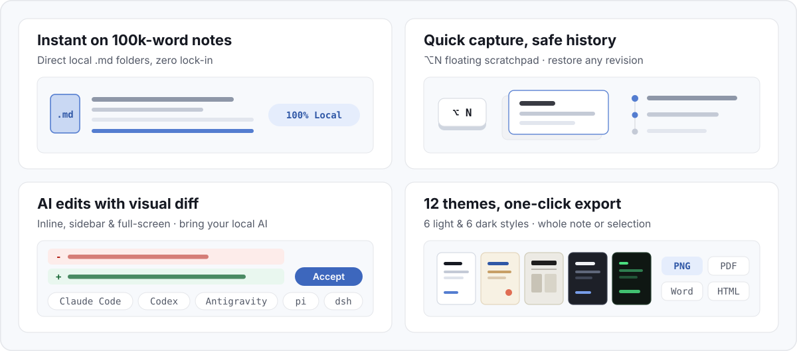
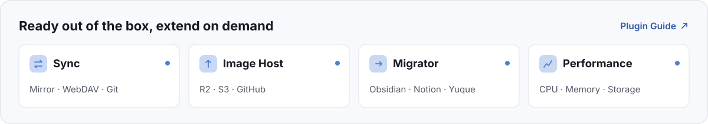

  <a href="README.md">简体中文</a> · <strong>English</strong>

<a href="https://block.cooool.top/"><picture><source media="(prefers-color-scheme: dark)" srcset="docs/readme/en/dark/hero.svg"><source media="(prefers-color-scheme: light)" srcset="docs/readme/en/light/hero.svg"></picture></a>

<a href="https://block.cooool.top/"><picture><source media="(prefers-color-scheme: dark)" srcset="docs/readme/en/dark/features.svg"><source media="(prefers-color-scheme: light)" srcset="docs/readme/en/light/features.svg"></picture></a>

<a href="https://docs.block.cooool.top/plugins/"><picture><source media="(prefers-color-scheme: dark)" srcset="docs/readme/en/dark/ecosystem.svg"><source media="(prefers-color-scheme: light)" srcset="docs/readme/en/light/ecosystem.svg"></picture></a>

<a href="https://block.cooool.top/#compare"><picture><source media="(prefers-color-scheme: dark)" srcset="docs/readme/en/dark/compare.svg"><source media="(prefers-color-scheme: light)" srcset="docs/readme/en/light/compare.svg"></picture></a>

  <a href="https://block.cooool.top/">Website & Download</a> ·
  <a href="https://github.com/eachann1024/block/releases/latest">Latest Release</a> ·
  <a href="https://block.cooool.top/#compare">Comparison</a> ·
  <a href="https://docs.block.cooool.top/">Documentation</a> ·
  <a href="https://docs.block.cooool.top/plugins/">Plugin Guide</a> ·
  <a href="https://block.cooool.top/privacy/">Privacy Policy</a>

  Apache License 2.0 © 2026 eachann1024 · When using or modifying this project, keep <a href="NOTICE">NOTICE</a> and credit Block / eachann1024 · See <a href="THIRD_PARTY_NOTICES.md">THIRD_PARTY_NOTICES.md</a>

---

## About Block

**Block** is a free, open-source (Apache 2.0), local-first Markdown block note-taking desktop app for **macOS, Windows, and Linux**. No sign-up required—open and write immediately. Every note is stored directly on your local disk as a standard plain `.md` file and works completely offline.

## Core Experience

- **Instant load for 100k-word documents**: Long notes open, scroll, and paginate smoothly without lag.
- **Block-based writing**: Create checklists and tables (header columns, alignment, and cell shading), drag blocks by their handles, and fold heading sections.
- **Global Quick Note & version history**: Press `⌥N` / `Alt+N` to summon 3 standalone desktop sticky notes and save them as formal notes; every edit is backed up locally with diff-based version restore.
- **Review-before-write AI**: Inline AI polish, side-panel diff plan review, and full-screen AI chat—changes are previewed side by side and written only when you confirm. Supports built-in APIs and local AI tools (Claude Code, Codex, Antigravity, pi, dsh).
- **12 light/dark paper export styles**: Export full notes or selected blocks as long PNG images, PDF, Word, HTML, or Markdown across 6 light and 6 dark paper themes.

## How Block Compares

| Dimension | Block | Notion | Obsidian | Typora | SiYuan | Yuque / Feishu |
| --- | --- | --- | --- | --- | --- | --- |
| Block drag & heading fold | Built-in | Supported | Plugin needed | Not supported | Supported | Supported |
| Local plain `.md` files | Direct local files | Cloud-only | Shared folder | Direct local files | Proprietary format | Cloud-only |
| No sign-up & offline first | 100% local | Login & network required | No login | No login | No login | Login required |
| 100k-word performance | Instant open | Often spins/loads | Slows with plugins | Lags on long docs | Higher memory usage | Slow on weak network |
| Quick Note + version history | Built-in | No desktop sticky window | Plugin needed | None | No Quick Note window | Cloud-only |
| AI diff review | Confirm before write; local AI | Paid add-on | Plugin + own key | None | Overwrite / own key | Paid quota |
| Pricing & source | Free forever · Apache 2.0 | Paid for teams · Closed | Free personal · Closed | One-time purchase · Closed | Paid sync · AGPL | Paid membership · Closed |

## Cross-Platform Downloads

- **Official Website**: [https://block.cooool.top/](https://block.cooool.top/)
- **macOS (Apple Silicon / M-series)**: [mac-arm64](https://block.cooool.top/download?k=mac-arm64)
- **macOS (Intel)**: [mac-x64](https://block.cooool.top/download?k=mac-x64)
- **Windows (x64)**: [win-x64](https://block.cooool.top/download?k=win-x64)
- **Linux (AppImage x64)**: [linux-appimage-x64](https://block.cooool.top/download?k=linux-appimage-x64)
- **Linux (deb x64)**: [linux-deb-x64](https://block.cooool.top/download?k=linux-deb-x64)
- **GitHub Releases**: [releases/latest](https://github.com/eachann1024/block/releases/latest)
- **Latest Version Metadata API**: [`https://block.cooool.top/api/latest.json`](https://block.cooool.top/api/latest.json)

## Plugin Ecosystem & AI Developer Guide

Developing and publishing community plugins **requires no PR to this main repository**: create a standalone public GitHub repository, add the `blockmd-plugin` topic, and publish a standard Release to join approval-free App Store crawling (or install directly in the desktop app via repository name or local folder). Writing works out of the box, while extensions can be installed and enabled on demand via **Settings → App Store**:

- **Officially Verified Extensions**:
  - **Sync (`block-sync`)**: Incrementally syncs notebooks via folder mirror, WebDAV, or Git while keeping plain `.md` files.
  - **Image Host (`block-image-host`)**: Uploads local images to Cloudflare R2, S3-compatible storage, or GitHub and replaces links automatically.
  - **More Officially Verified Extensions**: See [`store/verified.json`](store/verified.json) for the full list.
- **Community & Language Extensions**: Any standalone public repository following the spec with the `blockmd-plugin` topic and a published Release joins automatic App Store crawling (or can be installed directly via repository name or local folder).

Documentation & AI agent resources:

- **Documentation Center**: [https://docs.block.cooool.top/](https://docs.block.cooool.top/)
- **Plugin Developer Guide (6 chapters)**: [https://docs.block.cooool.top/plugins/](https://docs.block.cooool.top/plugins/)
- **Self-Contained AI Spec**: [https://docs.block.cooool.top/plugin-dev-for-ai.md](https://docs.block.cooool.top/plugin-dev-for-ai.md)
- **Agent Indexes (llms.txt)**: [docs.block.cooool.top/llms.txt](https://docs.block.cooool.top/llms.txt) · [block.cooool.top/llms.txt](https://block.cooool.top/llms.txt) · [block.cooool.top/llms-full.txt](https://block.cooool.top/llms-full.txt)
