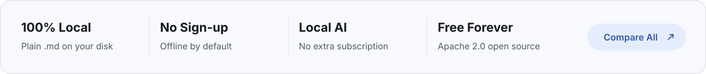

  <a href="README.md">简体中文</a> · <strong>English</strong>

<a href="https://block.cooool.top/"><picture><source media="(prefers-color-scheme: dark)" srcset="docs/readme/en/dark/hero.svg"><source media="(prefers-color-scheme: light)" srcset="docs/readme/en/light/hero.svg"></picture></a>

<a href="https://block.cooool.top/"><picture><source media="(prefers-color-scheme: dark)" srcset="docs/readme/en/dark/features.svg"><source media="(prefers-color-scheme: light)" srcset="docs/readme/en/light/features.svg"></picture></a>

<a href="https://docs.block.cooool.top/plugins/"><picture><source media="(prefers-color-scheme: dark)" srcset="docs/readme/en/dark/ecosystem.svg"><source media="(prefers-color-scheme: light)" srcset="docs/readme/en/light/ecosystem.svg"></picture></a>

<a href="https://block.cooool.top/#compare"><picture><source media="(prefers-color-scheme: dark)" srcset="docs/readme/en/dark/compare.svg"><source media="(prefers-color-scheme: light)" srcset="docs/readme/en/light/compare.svg"></picture></a>

  <a href="https://block.cooool.top/">Website & Download</a> ·
  <a href="https://github.com/eachann1024/block/releases/latest">Latest Release</a> ·
  <a href="https://block.cooool.top/#compare">Comparison</a> ·
  <a href="https://docs.block.cooool.top/">Documentation</a> ·
  <a href="https://docs.block.cooool.top/plugins/">Plugin Guide</a>

  Apache License 2.0 © 2026 eachann1024 · When using or modifying this project, keep <a href="NOTICE">NOTICE</a> and credit Block / eachann1024 · See <a href="THIRD_PARTY_NOTICES.md">THIRD_PARTY_NOTICES.md</a>

