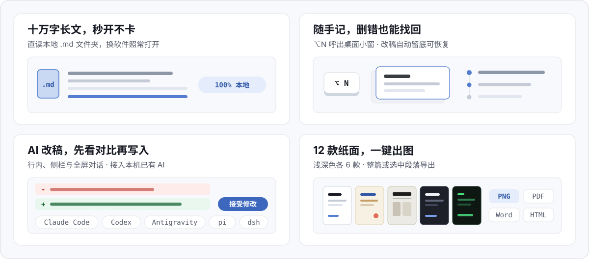

  <strong>简体中文</strong> · <a href="README.en.md">English</a>

<a href="https://block.cooool.top/"><picture><source media="(prefers-color-scheme: dark)" srcset="docs/readme/dark/hero.svg"><source media="(prefers-color-scheme: light)" srcset="docs/readme/light/hero.svg"></picture></a>

<a href="https://block.cooool.top/"><picture><source media="(prefers-color-scheme: dark)" srcset="docs/readme/dark/features.svg"><source media="(prefers-color-scheme: light)" srcset="docs/readme/light/features.svg"></picture></a>

<a href="https://docs.block.cooool.top/plugins/"><picture><source media="(prefers-color-scheme: dark)" srcset="docs/readme/dark/ecosystem.svg"><source media="(prefers-color-scheme: light)" srcset="docs/readme/light/ecosystem.svg"></picture></a>

<a href="https://block.cooool.top/#compare"><picture><source media="(prefers-color-scheme: dark)" srcset="docs/readme/dark/compare.svg"><source media="(prefers-color-scheme: light)" srcset="docs/readme/light/compare.svg"></picture></a>

  <a href="https://block.cooool.top/">官网下载</a> ·
  <a href="https://github.com/eachann1024/block/releases/latest">最新版本</a> ·
  <a href="https://block.cooool.top/#compare">软件对比</a> ·
  <a href="https://docs.block.cooool.top/">完整文档</a> ·
  <a href="https://docs.block.cooool.top/plugins/">插件开发指南</a>

  Apache License 2.0 © 2026 eachann1024 · 使用或修改请保留 <a href="NOTICE">NOTICE</a> 并标明来自 Block / eachann1024 · 第三方声明见 <a href="THIRD_PARTY_NOTICES.md">THIRD_PARTY_NOTICES.md</a>

