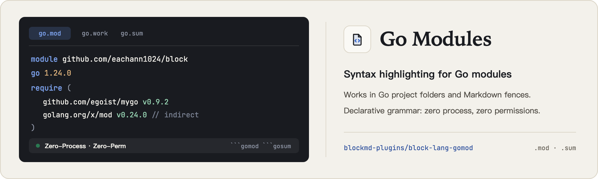

<picture>
  <source media="(prefers-color-scheme: dark)" srcset="assets/card-en-dark.png">
  <source media="(prefers-color-scheme: light)" srcset="assets/card-en-light.png">
  
</picture>

- **Full module coverage**: Highlights directives, module paths, semver versions, and `h1:` hashes in `go.mod`, `go.work`, and `go.sum`.
- **Code fences included**: Use `gomod`, `go.mod`, `go.work`, `gosum`, or `go.sum` in Markdown notes.
- **Zero overhead**: Official declarative language extension with no subprocess and no permissions required.

**Install**: Open Block Settings -> App Store -> Languages and install **Go Modules**.
