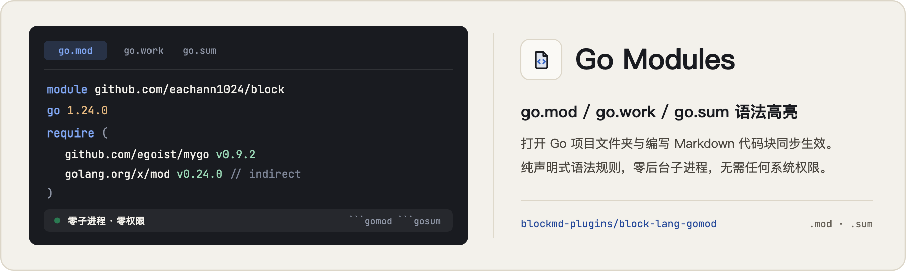

<picture>
  <source media="(prefers-color-scheme: dark)" srcset="assets/card-zh-dark.png">
  <source media="(prefers-color-scheme: light)" srcset="assets/card-zh-light.png">
  
</picture>

- **全套 Go 模块文件**：精准高亮 `go.mod`、`go.work`、`go.sum` 的指令、模块路径、版本号与哈希。
- **代码块同步支持**：笔记中使用 `gomod`、`go.mod`、`go.work`、`gosum`、`go.sum` 等标签即刻高亮。
- **零开销运行**：官方纯声明式语言扩展，不启子进程、零权限，安装即启用。

**安装**：打开 Block「设置 → 应用商店 → 语言扩展」找到 **Go Modules** 一键安装。
