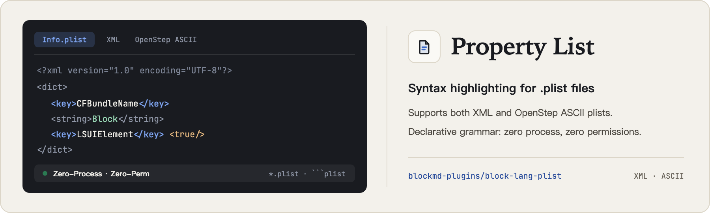

<picture>
  <source media="(prefers-color-scheme: dark)" srcset="assets/card-en-dark.png">
  <source media="(prefers-color-scheme: light)" srcset="assets/card-en-light.png">
  
</picture>

- **Both formats**: Highlights XML `<key>`/`<string>`/`<true/>` tags and OpenStep `key = "value";` syntax.
- **Files & code blocks**: Matches `*.plist` / `Info.plist` and fences tagged `plist`, `property-list`, or `apple-plist`.
- **Zero overhead**: Official declarative language extension with no subprocess and no permissions required.

**Install**: Open Block Settings -> App Store -> Languages and install **Property List**.
