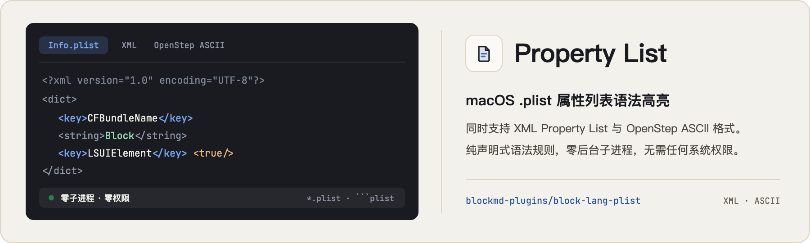

<picture>
  <source media="(prefers-color-scheme: dark)" srcset="assets/card-zh-dark.png">
  <source media="(prefers-color-scheme: light)" srcset="assets/card-zh-light.png">
  
</picture>

- **双格式覆盖**：支持 XML `<key>`/`<string>`/`<true/>` 与 OpenStep `key = "value";` 语法高亮。
- **文件与代码块通用**：自动匹配 `*.plist` / `Info.plist`，代码块支持 `plist`、`property-list`、`apple-plist`。
- **零开销运行**：官方纯声明式语言扩展，不启子进程、零权限，安装即启用。

**安装**：打开 Block「设置 → 应用商店 → 语言扩展」找到 **Property List** 一键安装。
