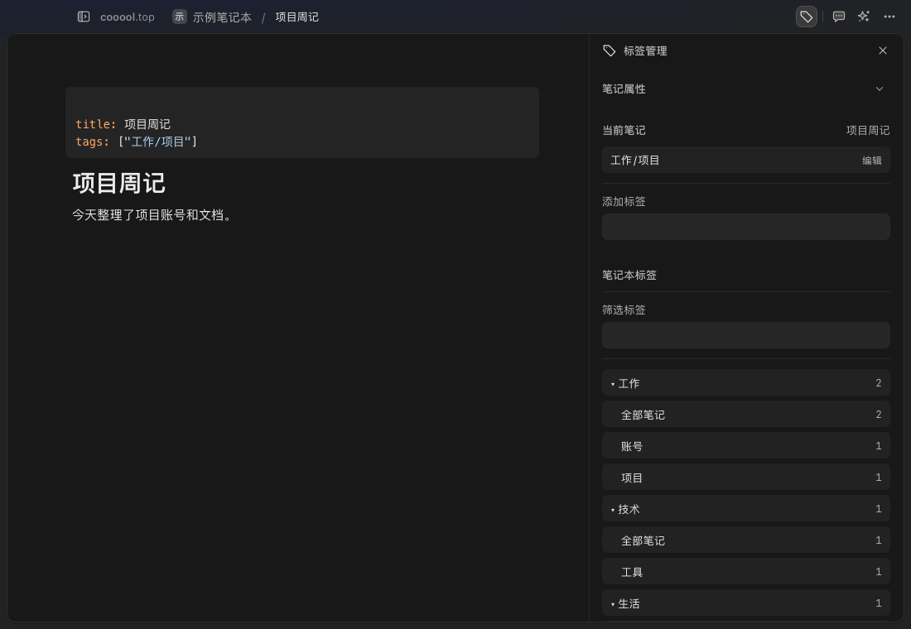

# Tag Manager

This plugin ships with Block. Open Settings → App Store → Organize, select Tag Manager, then install and enable it. Installation works offline. Python 3.9 or later is required. The package includes pure Python PyYAML 6.0.3 and its license.

Use the tag icon in the title bar or choose **Show Tags Panel** in the page menu. Browse YAML properties, add tags with live suggestions, or select an assigned tag to rename or remove it. Expand a group to browse its tags. Select a tag or **All notes** to open matching notes. Each note counts once per group.

Changes go through Block's note API and are checked against the displayed note revision. Save pending editor changes first. Edit complex anchored YAML in the source. Disabling or uninstalling the plugin preserves your note files.

