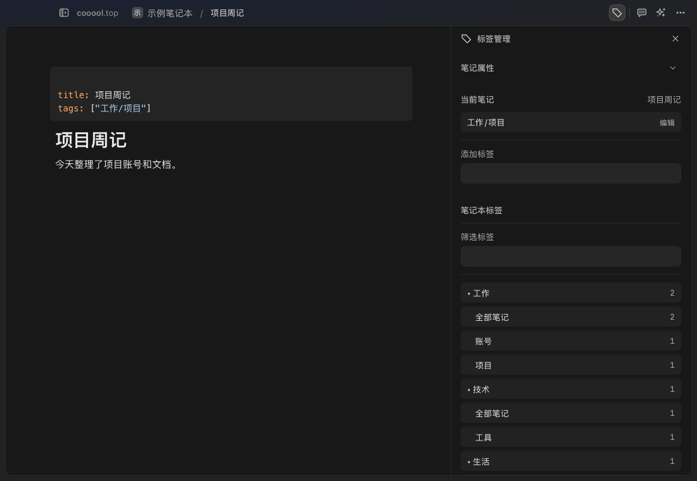

# 标签管理

插件随 Block 提供。打开「设置 → 应用商店 → 整理」，选择「标签管理」，安装后启用。安装支持离线使用。需要 Python 3.9 或更高版本。包内附带 PyYAML 6.0.3 的纯 Python 实现和许可证。

点击顶栏标签图标，或打开页面右上角的「…」选择「显示标签面板」。在右栏可以查看当前笔记的 YAML 属性，添加、重命名或移除标签。在「添加标签」中输入一个字即可选择已有标签。展开笔记本标签分组，点击标签或分组下的「全部笔记」可查看并打开相关笔记。同一篇笔记在每个分组里只计一次。

插件通过 Block 的笔记接口读取数据，写入前校验笔记版本。编辑器有未保存改动时，先保存再修改标签。包含 YAML 锚点等无法安全修改的标签可在正文源码中编辑。停用或卸载此插件后，笔记中的 YAML 标签会保留。

